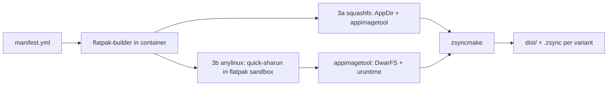

# flat2appimage plan

Convert a Flathub manifest repo into AppImages + zsync files, built fully in a container.
Example target: `io.github.tobagin.karere` (GNOME 51, meson + Rust, CEF/Chromium embedded).

Two variants, following the AppManager build scripts (copied to `scripts/` as reference):

- `squashfs` (small): classic `appimagetool`, hand-written AppRun, relies on host libraries. Template: `scripts/make-appimage.sh`.
- `anylinux` (large): `quick-sharun` + sharun + uruntime + DwarFS, fully portable. Template: `scripts/make-anyimage.sh`.

## Status (2026-10-15)

Implemented and verified:

- One command builds both variants plus `.zsync` files, fully in a container:
  - `io.github.tobagin.karere` (Rust + CEF, yml manifest, ELF binary): both variants smoke tested.
  - `com.github.tchx84.Flatseal` (gjs + meson, JSON manifest, script launcher): both variants smoke tested.
- Manifest can be a local file or an http(s) URL. GitHub blob URLs are converted to raw, downloads are
  cached under `~/.cache/flat2appimage/manifests/<app>/` (that directory doubles as the app dir, so a
  per-app `flat2appimage.conf` can live there too).
- Container bootstrap (toolbox auto-create + dependency install, podman fallback), caches reused across builds.
- Manifest introspection: command, version (first git tag), finish-args envs, desktop file, icon, name.
- squashfs variant: AppDir assembly, generated AppRun, optional update info, zsync.
- anylinux variant: quick-sharun + uruntime + DwarFS packaging, static patchelf bind-mount.
- Generic quirks fixed in the tool (details in "M2 findings"): JSON manifest file names, `dbus-daemon`
  sandbox leftover that hung `flatpak build`, quick-sharun locale conflict abort, `/app` prefix in
  gjs launchers, `GSETTINGS_SCHEMA_DIR` for script launchers.

Left to do:

- M3: GitHub Actions (x86_64 + aarch64), release upload, `gh-releases-zsync` update info.
  Needs the real repository; `UPDATE_REPO` is a placeholder and local builds use relative zsync URLs.
- aarch64: never built or tested locally; planned via GitHub arm64 runners.
- Re-run karere `--variant all` on the current tool to confirm no regressions from the M2 fixes
  (its artifacts were built before them).
- Phase 5 checks, either in the tool or CI: `appimageupdatetool` on the embedded update info,
  zsync delta apply, anylinux run in a clean container without flatpak and without FUSE.
- Decide update-info patterns per variant (and whether the squashfs variant gets update info at all).
- Optional: offline/mirrored tool downloads (quick-sharun, sharun, appimagetool) for reproducible CI.

## Success criteria

1. One command produces both variants plus `.zsync` files:
   - `dist/Karere-<ver>-x86_64.AppImage` (squashfs, small)
   - `dist/Karere-<ver>-anylinux-x86_64.AppImage` (portable, large)
2. Build runs entirely in a container. Local engine: toolbox. Later: GitHub Actions container.
3. Local publishing first (relative zsync URLs); GitHub releases later (`gh-releases-zsync` update info).
4. The anylinux variant runs on a clean x86_64 Linux without flatpak and without FUSE
   (uruntime fallback chain: FUSE -> namespaces -> extract-and-run).
   The squashfs variant targets modern GNOME desktops and uses host libraries.
5. Other Flathub manifests work without code changes. App quirks go into a small overrides file.
6. aarch64 is built later, in GitHub Actions on arm64 runners. Not locally.

## Decisions

### Language: bash, single script

- The pipeline is CLI glue: `flatpak-builder`, `flatpak build`, `quick-sharun`, `appimagetool`, `zsyncmake`.
- The container pins all dependencies, so a compiled binary buys nothing at this size.
- House style: `dnf2appimage`, `appimageinfo` and `quick-sharun` itself are shell.
- No YAML parsing needed: `flatpak-builder --show-manifest` prints canonical JSON, `jq` reads the few fields we need.
- Upgrade path: if this grows into an app matrix with caching/parallel builds, port to Go.
- Rejected: Python (banned), Go/Rust (build infra, no functional gain now).

### Container: toolbox now, GitHub container later

- Local builds re-exec into toolbox, the same pattern `make-anyimage.sh` uses with podman:
  `toolbox run -c flat2appimage env F2A_IN_CONTAINER=1 bash "$0" "$@"`.
- Auto setup: create the container if missing, `dnf install flatpak flatpak-builder jq zsync wget`.
- Reuse the same container across builds (like `make-anyimage.sh` reuses its podman container),
  so flathub runtime/SDK downloads are cached.
- Engine abstraction: `--engine toolbox|podman`. The podman path (`podman run -v "$PWD":/src -w /src ...`)
  covers machines without toolbox and previews the CI setup.
- flatpak-builder needs unprivileged user namespaces (bwrap inside the container). Verify in M0.
- M3 (later): GitHub Actions. AppManager uses `container: ghcr.io/pkgforge-dev/archlinux:latest`,
  `pkgforge-dev/anylinux-setup-action@v1`, runners `ubuntu-latest` + `ubuntu-24.04-arm`, release via
  `softprops/action-gh-release`. flat2appimage needs flatpak-builder in the job container
  (flathub builder image or our own Containerfile). Decide at M3.

### Packaging: two variants, following AppManager

Both variants share the flatpak build (phases 0-2), then diverge.

**squashfs (small)**, like `scripts/make-appimage.sh`:

- AppDir contains the finished app tree under `usr/`.
- Hand-written `AppRun` (AppManager pattern): exports `LD_LIBRARY_PATH` (including the CEF dir),
  `GSETTINGS_SCHEMA_DIR` when schemas exist, `XDG_DATA_DIRS`, `PATH`, then execs the binary.
- Desktop file and icon at the AppDir root.
- Classic `appimagetool` (AppImage/appimagetool continuous), downloaded if missing.
- `--updateinformation` when a repo is configured, then `zsyncmake`.
- Runtime assumption: GNOME desktop with GTK4/libadwaita and typical Chromium deps (libnss, libgbm, ...).

**anylinux (large)**, like `scripts/make-anyimage.sh`:

- `quick-sharun` inside the flatpak sandbox deploys binaries + libraries (lib4bin), generates `lib.path`,
  AppRun, hooks and `.env`.
- `--make-appimage` uses pkgforge `appimagetool`, which packs the AppDir as DwarFS, concatenates it
  onto `uruntime`, and writes ELF sections including update info. This is where sharun, uruntime and dwarfs come in.
- Versions are pinned transitively by pinning the quick-sharun revision (raw URL at a commit + sha256 in the repo).
- Optional: mirror quick-sharun downloads (`sharun` tarball, `appimagetool`) into `cache/` and pass
  `SHARUN_LINK` / `APPIMAGETOOL_LINK` as `file://` URLs for offline, reproducible builds.

**Shared conventions (from AppManager scripts):**

- `OUTPATH=dist`, `OUTNAME=<Name>-<ver>[-anylinux]-<arch>.AppImage`, `UPINFO` exported before packaging.
- `<ver>` from the first git source `tag` in the manifest (strip leading `v`), fallback `unknown`.
- `<Name>` from the desktop file `Name=` key (`Karere`).
- zsync while local: `zsyncmake -u "$OUTNAME" -o "$OUT.zsync"` (relative URL, same directory, like `make-appimage.sh`).
  On GitHub: `gh-releases-zsync` update info with non-overlapping per-variant patterns.
- `scripts/fetch-dwarfs-tools.sh`, `fetch-squashfuse.sh`, `build-unsquashfs.sh` and `fetch-zsync-tools.sh`
  are AppManager runtime tool fetches (AppManager bundles those tools for its own sandboxing).
  flat2appimage does not need them. Leave them in place.

## Pipeline



### Phase 0: arguments + container re-exec

```
flat2appimage [--variant all|squashfs|anylinux] [--arch ARCH] [--dist DIR]
              [--update-info VALUE] [--keep] [--debug]
              [--container NAME] [--engine toolbox|podman] MANIFEST
```

- MANIFEST is a local file or an http(s) URL; GitHub blob URLs are converted to raw and the download
  is cached in `~/.cache/flat2appimage/manifests/`.
- app-id from manifest file name stem (flathub convention), overridable with `--app-id`.
- arch defaults to container `uname -m`; `x86_64` first, `aarch64` later.

### Phase 1: manifest introspection (in container)

- `flatpak-builder --show-manifest MANIFEST > build/manifest.json` (canonical JSON, includes included files).
- `jq` extracts: `command`, `runtime`, `runtime-version`, `sdk`, `rename-icon`, `rename-desktop-file`,
  the first git source `tag` (version), and `finish-args` `--env=` entries.
- Translate finish-arg envs for the AppDir:
  - `/app/...` paths become `${SHARUN_DIR}/...`
  - `LD_LIBRARY_PATH` becomes `SHARUN_EXTRA_LIBRARY_PATH` (karere: `/app/lib/cef`)
- Optional `flat2appimage.conf` next to the manifest (sourced, per-app):
  - extra binaries/dirs passed to quick-sharun, extra `DEPLOY_*` flags, extra `.env` lines, `ADD_HOOKS`.

### Phase 2: build the flatpak

```sh
flatpak remote-add --if-not-exists --user flathub https://dl.flathub.org/repo/flathub.flatpakrepo
flatpak-builder --user --install-deps-from=flathub --force-clean --disable-rofiles-fuse \
  --state-dir="$BUILD/.flatpak-builder" --repo="$BUILD/repo" \
  "$BUILD/build" "$MANIFEST"
```

- Full build (build + cleanup + finish + export), so `build/files` is the final app tree.
- `--disable-rofiles-fuse`: rofiles-fuse needs `/dev/fuse`, which toolbox containers lack (verified in M0).
- `--install-deps-from=flathub` pulls runtime, SDK and sdk-extensions (rust-stable) automatically.
- Copy `build/files/manifest.json` (resolved manifest) into `dist/` for provenance.
- State dir + container caches make rebuilds fast.

### Phase 3a: squashfs variant (small, no sandbox needed)

- Assemble the AppDir from `$BUILD/build/files` (finished app tree) under `usr/`.
- Write the hand-written `AppRun` (AppManager pattern), desktop file and icon at the AppDir root.
- Run classic `appimagetool` with `--updateinformation` when a repo is configured.
- Targets modern GNOME desktops: GTK4, libadwaita, libnss, libgbm and audio must exist on the host.
- M0 check: `strings` the binaries for hardcoded `/app` paths. If present, either patch them or treat the app
  as anylinux-only.

### Phase 3b: anylinux variant (large, quick-sharun inside the flatpak sandbox)

```sh
flatpak build --share=network --filesystem="$OUT" "$BUILD/build" bash -lc "$BUNDLE_SCRIPT"
```

- Sandbox layout: `/app` = app files, `/usr` = SDK, `/usr/share` = runtime data.
  This is why bundling runs here: quick-sharun reads libraries and data from `/usr` and `/app` like from a normal install.
- Note: `flatpak build` mounts the SDK (not the Platform) at `/usr`. Same shared libraries, and it is the only place
  where the tooling (`strings`, `strip`, ...) exists. If an audit shows SDK-only libs leaking, switch to
  `flatpak build -r` (Platform at `/usr`) and bind-mount the missing tools.
- The SDK has no `patchelf` (M0 finding). A pinned static patchelf (NixOS/patchelf release, sha256 checked) is
  cached in `~/.cache/flat2appimage/tools`, bind-mounted into the sandbox and prepended to `PATH`.
- Bundle script (streamed, logged):
  1. `APPDIR=$OUT/AppDir`; `cp -a /app/. "$APPDIR/"`; drop `manifest.json` and `/app/lib/debug`.
  2. Fetch pinned quick-sharun script (from cache via `file://`, sha256 checked).
  3. Export `DESKTOP`, `ICON` (found under `/app/share`), `OUTPATH`, `OUTNAME`, `MAIN_BIN` from manifest `command`.
  4. `quick-sharun /app/bin/<command> <extra args>` (karere: `/app/lib/cef`).
  5. Write `$APPDIR/.env` from the translated finish-args envs.
  6. `quick-sharun --make-appimage`.

### Phase 4: zsync + update info (both variants)

- Local builds: `zsyncmake -u "$OUTNAME" -o "$OUT/$OUTNAME.zsync" "$OUT/$OUTNAME"` (relative URL, like `make-appimage.sh`).
- GitHub builds: `UPINFO="gh-releases-zsync|<owner>|<repo>|latest|<pattern>.zsync"` embedded during packaging
  (`.upd_info` section), then `zsyncmake` with the release URL.
- Per-variant patterns must not overlap, e.g. `*anylinux*<arch>.AppImage.zsync` vs `<Name>-*-<arch>.AppImage.zsync`.
  Test with `appimageupdatetool`.
- `<owner>/<repo>` lives in `flat2appimage.conf`, nothing hardcoded in the tool.

### Phase 5: verify (both variants)

- Quick self test in container: `./AppImage --appimage-extract-and-run`, or `quick-sharun --test` when `xvfb-run` exists.
- `ldd` sweep over bundled libraries: no `not found` (anylinux: everything bundled; squashfs: expected host deps documented).
- `objcopy --dump-section .upd_info=- AppImage` shows the update info.
- anylinux smoke test in a throwaway container without flatpak and without FUSE.
- zsync client test: apply the `.zsync` to an older copy of the file locally.

## karere specifics (first target)

- CEF: all of `/app/lib/cef` must be bundled (libcef.so, chrome-sandbox, locales, icudtl.dat, resources).
  Copied wholesale, and passed as an arg so quick-sharun collects `libcef.so` dependencies.
- finish-args: `LD_LIBRARY_PATH=/app/lib/cef` -> `SHARUN_EXTRA_LIBRARY_PATH` (anylinux) or `LD_LIBRARY_PATH`
  in `AppRun` (squashfs). `GSK_RENDERER=gl` -> `.env` / `AppRun`.
- squashfs variant: CEF goes to `usr/lib/cef` and must be on `LD_LIBRARY_PATH`. Host needs libnss, libgbm,
  GTK4, libadwaita and audio. The relocated locale dir (`/app/share/karere/locale`) is a hardcoded-path risk.
- CEF sandbox: chrome-sandbox cannot be SUID inside an AppImage. Likely needs user namespaces at runtime
  (host default) and/or `fix-namespaces.hook`. Verify in M0.
- dlopen detection: quick-sharun strace mode needs a display + `xvfb-run` inside the sandbox.
  Default `STRACE_MODE=0` there; add Chromium/CEF libs explicitly via `DEPLOY_ELECTRON=1`, `DEPLOY_P11KIT=1`.
  Revisit if runtime failures appear.
- Locale is moved by the manifest to `/app/share/karere/locale`. Check for hardcoded `/app` paths
  (`strings ... | grep /app`); use quick-sharun `PATH_MAPPING` (anylinux) or patching (squashfs) if needed.
- `--device=all`, `--filesystem=...` and dbus talk names lose their meaning in an AppImage; the app talks to
  host DBus directly. Only `--env=` entries need translation.

## Repo layout

```
flat2appimage                # the tool (bash), --variant all|squashfs|anylinux
README.md                    # usage overview, how it works
scripts/                     # AppManager scripts, copied as reference
  make-appimage.sh           # template for the squashfs variant
  make-anyimage.sh           # template for the anylinux variant (container bootstrap, UPINFO)
  fetch-*.sh, build-unsquashfs.sh   # AppManager runtime tools, unused here
io.github.tobagin.karere/    # first target (yml manifest, Rust + CEF)
com.github.tchx84.Flatseal/  # second target (JSON manifest, gjs + meson)
  (both app dirs: manifest + optional flat2appimage.conf)
docs/flat2appimage-plan.md   # this file
dist/                        # build output (gitignored)
```

## Milestones and verification

```
M0 spike (manual, karere)          -> done: assumptions verified
M1 tool end-to-end (karere)        -> done: one command, both variants + .zsync, smoke tested
M2 second app (GTK, gjs + meson)   -> done: Flatseal, tool now generic (findings below)
M3 GitHub Actions (x86_64, arm64)  -> todo: GH container build, release upload, zsync delta works
```

M0 checklist:

- `bwrap`/user namespaces work inside the container: `toolbox run -c flat2appimage bwrap --ro-bind / / true`.
- Tool availability inside the SDK sandbox: `awk cp env find grep ldd mv patchelf rm sha256sum sleep strings tar tr`,
  plus `xvfb-run`, `curl`.
- `quick-sharun` completes headless, then `--make-appimage` produces a runnable AppImage.
- squashfs variant assembled by hand and runs on the host under xvfb.
- `strings | grep /app` check on the binaries (hardcoded path risk).
- `.upd_info` is present and `zsyncmake` output is valid.
- AppImage runs in a clean container.

M2 findings (Flatseal: gjs + meson, JSON manifest):

- JSON manifests are common on Flathub; strip `.json` as well as `.yml`/`.yaml` from the manifest
  basename when deriving `APP_ID`.
- quick-sharun runs `dbus-launch` (session daemon). If the daemon outlives the bundle script it is
  reparented to bwrap (sandbox pid 1), so `flatpak build` never returns and the tool hangs. Fixed with
  an `EXIT` trap in `bundle.sh` that kills leftover `dbus-daemon` processes.
- quick-sharun runs under `set -e` and its runtime-locale `cp -r` fails when the app ships its own
  `share/locale` (runtime locale symlinks dangle in the SDK sandbox). Guard: when the app has locales,
  set `DEPLOY_LOCALE=0`.
- meson/gjs launcher scripts hardcode `prefix: "/app"` (also `libdir`, `datadir`). The tool rewrites
  these to `GLib.getenv("APPDIR")` plus the per-variant subprefix (squashfs: `/usr`, anylinux: root)
  and prepends a `const GLib` import. Verified: app starts from both variants.
- Non-ELF (script) main binaries bypass sharun's env setup: `GSETTINGS_SCHEMA_DIR` stayed unset and
  GLib could not find the app's compiled schemas. The tool now writes `bin/zz-f2a-env.hook`
  (AppRun.sh sources `bin/*.hook`).
- gjs itself is not bundled (quick-sharun deploys libs for ELF binaries only), so JS apps need host
  `gjs` (GNOME baseline), same as the squashfs variant. ELF apps (karere) stay self-contained.

## Risks / open items

- Tool gaps in the sandbox (patchelf, ldd, xvfb-run). Mitigation: bind-mount static tools via `--filesystem`, prepend `PATH`.
- `flatpak build` succeeds only if bwrap works inside the container engine. Verified in M0; podman fallback with `--privileged`.
- CEF quirks (sandbox, dlopen, hardcoded `/app` paths) are the main app-level risk. Spike driven.
- squashfs variant: any hardcoded `/app` path or missing host dependency breaks it. gjs launchers are
  rewritten automatically; other script types (python/shell wrappers) would need a per-app patch or
  an anylinux-only decision.
- First build downloads runtime/SDK (~1.5 GB) and CEF (~500 MB) and compiles Rust: expect 30+ min cold.
- zsync URL must be stable. Release process must upload the AppImage + `.zsync` atomically.
- aarch64: flatpak-builder runs on arm64 GitHub runners (or a multi-arch builder container). CEF archive exists for aarch64.

## Resolved

1. GitHub owner/repo: placeholder for now (`UPDATE_REPO` stays empty until releases exist).
2. One tool with `--variant all|squashfs|anylinux` (default `all`).
3. squashfs variant baseline: modern GNOME desktop (GTK4/libadwaita present) is acceptable.
